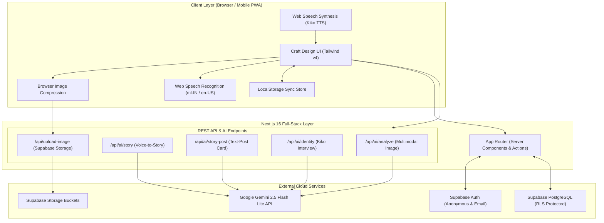
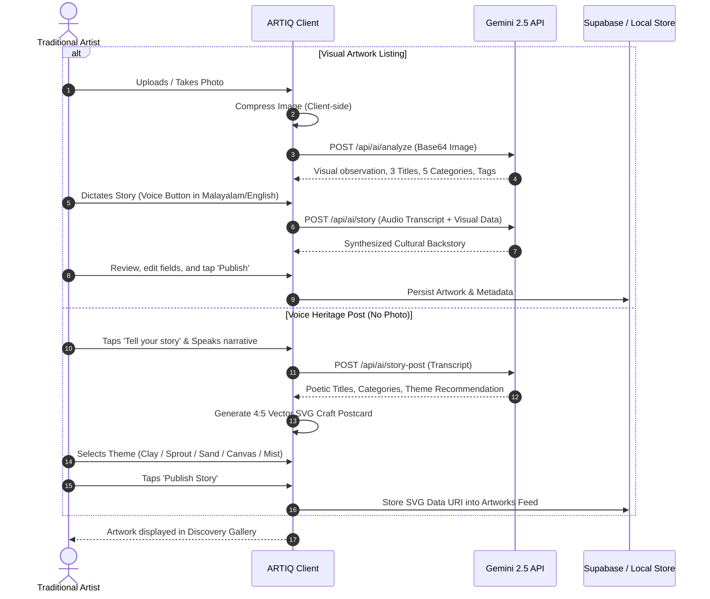
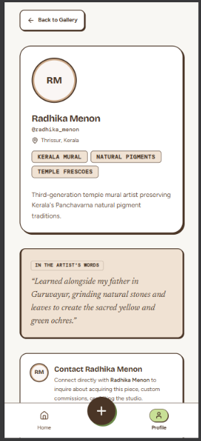

# ARTIQ — Every Artist Deserves to Be Seen

> An AI-powered digital identity, portfolio, and discovery platform built for traditional and independent artists.

[](https://nextjs.org/)
[](https://www.typescriptlang.org/)
[](https://ai.google.dev/)
[](https://supabase.com/)
[](https://tailwindcss.com/)

---

## 1. Project Overview

**ARTIQ** is an assistive web platform designed to eliminate the digital divide for grassroots artisans, folk craftspeople, and independent creators. 

For centuries, indigenous artisans have perfected intricate art forms—from Kerala murals, terracotta pottery, and Aranmula metal mirrors to handloom weaves and wood carvings. However, the modern digital creator economy demands skills that have nothing to do with artistic craftsmanship: writing search-engine-optimized captions, researching viral hashtags, navigating English-centric user interfaces, and playing algorithmic follower-growth games.

**ARTIQ changes the paradigm from "Marketing-First" to "Craft-First":**
- **Effortless Onboarding**: Traditional artists can go from zero digital presence to a published portfolio in under five minutes.
- **Multimodal AI Assistance**: Artists simply snap a photo of their artwork. Google Gemini multimodal intelligence observes the visual details and drafts compelling titles, descriptions, taxonomy tags, and keywords—without inventing false cultural claims.
- **Bilingual Voice Storytelling**: Artists can speak naturally in Malayalam or English. ARTIQ transcribes and weaves their oral traditions, inspirations, and techniques into authentic cultural narratives.
- **Kiko — The Interactive Voice Persona**: An empathetic animated guide conducts a conversational audio interview, reading questions aloud and listening to artist responses to construct a complete digital identity automatically.
- **Image-Free Text-Story Posts**: Spoken folklore, poems, and heritage stories without accompanying photos are instantly transformed into elegant 4:5 vector SVG craft postcards across 5 earth-toned themes.
- **Merit-Based Discovery**: Artworks are showcased in a tactile, responsive masonry gallery where visitors discover work based on aesthetic beauty, technique, and cultural story—not follower metrics or ad spend.

---

## 2. Problem Statement
### PS-02: From Craft to Click (Artist Visibility)

Traditional and independent artists face steep barriers when trying to showcase their creations online:

1. **Linguistic & Technological Barriers**:
   Most e-commerce and social portfolio platforms are English-dominated and desktop-heavy. Non-English speaking artisans (e.g., regional Malayalam speakers) face severe friction navigating complex forms and menus.

2. **The "Blank Page" Marketing Dilemma**:
   Master artisans know every brushstroke and clay texture, but struggle to write compelling e-commerce copy, categorize their work within standard taxonomies, or select high-visibility hashtags.

3. **Loss of Cultural Context & Heritage Stories**:
   Modern social media favors 5-second rapid-consumption video over deep context. The cultural heritage, sacred significance, and generational lineage behind traditional artifacts are lost in transit.

4. **Algorithmic Invisibility & Follower Bias**:
   Conventional platforms prioritize creators with high follower counts, frequent posting schedules, and paid promotions. As a result, exceptional rural and independent artisans remain invisible ("Craft without Click").

**ARTIQ directly solves PS-02** by providing a zero-friction bridge from physical craftsmanship to global digital visibility through ambient multimodal AI and voice interactions.

---

## 3. Key Features

### 📸 1. Multimodal AI Artwork Analysis
- **Observation-Only Visual Intelligence**: Powered by Google Gemini (`gemini-2.5-flash-lite`), ARTIQ examines uploaded artwork images to detect medium, colors, style, and subject matter without hallucinating unverified provenance.
- **Automated Title & Taxonomy Suggestions**: Generates 3 poetic title options, primary craft categories (Mural, Pottery, Weaving, Woodwork, Sculpture, etc.), and discoverability hashtags.

### 🎙️ 2. Voice-to-Story Engine (Bilingual Malayalam & English)
- Integrated speech recognition (`ml-IN` and `en-US`) allows artists to narrate the backstory of their piece by simply speaking.
- AI merges the spoken story with the visual observations into an evocative, authentic narrative rendered in classic Newsreader serif typography.

### 🎭 3. Kiko — The Interactive Identity Interviewer
- An animated character guide styled to match the warm, earthy aesthetic of the platform.
- **Reads Questions Aloud**: Uses Web Speech Synthesis with regional pitch and rate modulation to ask portfolio questions (bio, artistic journey, specialties, preferred medium).
- **Voice Response Capture**: Listens to artist spoken replies and synthesizes them into a structured, professional artist profile.

### 📜 4. Image-Free Text-Story Posts with Vector Craft Cards
- Enables storytelling even when an artist does not have a high-resolution photo available.
- Instantly renders a vector SVG craft postcard (800 × 1000 px, 4:5 aspect ratio) with high-contrast Newsreader typography, ornamental quotes, and corner flourishes.
- **5 Selectable Rule 8 Craft Themes**:
  - *Canvas Warmth* (`#F8F7F3` / `#4A3526`)
  - *Terracotta Clay* (`#E3B5A0` / `#4A3526`)
  - *Sprout Moss* (`#E3F0CB` / `#4A3526`)
  - *Sand Dune* (`#CDAA8A` / `#4A3526`)
  - *Mist Minimal* (`#EFEFEC` / `#4A3526`)
- Generates ultra-lightweight SVG Data URIs (~3KB) that require zero cloud storage upload overhead.

### ⚡ 5. Frictionless Demo Mode (Zero Sign-Up Gate)
- Instant 1-click **"Try Demo"** access using Supabase Anonymous Authentication (`signInAnonymously`).
- Automatically seeds the workspace with rich pre-configured artworks and enables guest artists to experience the full AI creation flow immediately.

### 🎨 6. Tangible "Craft Design Tokens" (Rule 8 System)
- **Zero Black Rule**: Pure black (`#000000`) is strictly banned. Deep Espresso (`#4A3526`) is utilized across all text, borders, and hard shadows.
- **Physical Sticker Controls**: All buttons, cards, and interactive chips feature a physical 2px outline and a hard `3px 3px 0 #4A3526` offset drop-shadow that mechanically translates `translate(3px, 3px)` when tapped.
- **Earthy Palette**: Grounded in natural tones—Canvas (`#F8F7F3`), Sand (`#CDAA8A`), Leaf (`#C8E096`), Sprout (`#E3F0CB`), and Clay (`#E3B5A0`).

### 🖼️ 7. Discovery-First Responsive Gallery
- Pure visual discovery without follower counts, view counts, or algorithm bias.
- Responsive masonry grid layout with category filter drawers, instant search, like/save persistence, and detailed lightbox views.

---

## 4. Technology Stack

| Layer | Technologies | Purpose |
|---|---|---|
| **Frontend Framework** | **Next.js 16.4 (App Router, Turbopack)** | Server Components, Server Actions, optimized hybrid rendering |
| **UI Library & Components** | **React 19, Base UI, Lucide React** | Accessible headless primitives, physical sticker craft components |
| **Styling Engine** | **Tailwind CSS v4** | Modern utility-first styling with custom Rule 8 design tokens |
| **Artificial Intelligence** | **Google Gemini 2.5 Flash Lite (`@google/genai`)** | Multimodal artwork image analysis, story synthesis, title extraction |
| **Voice & Audio** | **Web Speech Recognition & Synthesis APIs** | Bilingual speech-to-text and text-to-speech for Malayalam and English |
| **Backend & Database** | **Supabase (PostgreSQL, Row Level Security)** | User authentication, anonymous demo auth, structured relational storage |
| **Image Processing** | **`browser-image-compression`** | Client-side image resizing and compression prior to upload |
| **Resilience & Storage** | **Browser LocalStorage + Supabase Storage** | Dual-tier persistence ensuring full offline and demo mode operability |
| **Observability** | **Pino & Pino-Pretty** | Structured high-performance logging across client and server |

---

## 5. System Architecture

### 5.1 High-Level Architecture Diagram



### 5.2 Create Art & Story Post Workflow



---

## 6. Installation & Setup Instructions

### Prerequisites
- **Node.js**: v20.x or higher
- **npm**: v10.x or higher (or `pnpm` / `yarn`)
- **Supabase Account**: A Supabase project with PostgreSQL database
- **Google AI Studio Key**: An active Gemini API Key ([Get one here](https://aistudio.google.com/))

### Step 1: Clone the Repository
```bash
git clone https://github.com/abelantoajith-commits/Artiq.git
cd Artiq
```

### Step 2: Install Dependencies
```bash
npm install
```

### Step 3: Configure Environment Variables
Create a `.env.local` file in the root directory by copying the example:
```bash
cp .env.example .env.local
```
Fill in your Supabase credentials and Gemini API key (see [Section 7](#7-environment-variables) for details).

### Step 4: Apply Database Migrations
Execute the SQL migrations located in `supabase/migrations/` in your Supabase SQL Editor:
1. `supabase/migrations/20261106_phase2_schema.sql` (Tables: profiles, artworks, categories, saves)
2. `supabase/migrations/20261107_demo_login_and_identity_interview.sql` (Anonymous auth, demo flag, identity fields)
3. `supabase/migrations/20261107_merge_story_streamline_artworks.sql` (Merged story schema adjustments)

*(Optional)* Run `supabase/seed.sql` to populate sample categories and test artworks.

### Step 5: Start the Development Server
```bash
npm run dev
```
Open [http://localhost:3000](http://localhost:3000) in your browser.

### Step 6: Code Quality & Token Verification
```bash
# Run ESLint and the strict Rule 8 Craft Design Token Guard
npm run lint

# Verify complete Next.js production build
npm run build
```

---

## 7. Environment Variables

| Variable | Environment | Required | Description | Example |
|---|---|:---:|---|---|
| `NEXT_PUBLIC_SUPABASE_URL` | Client & Server | **Yes** | Your Supabase project URL | `https://xyzcompany.supabase.co` |
| `NEXT_PUBLIC_SUPABASE_ANON_KEY` | Client & Server | **Yes** | Supabase anonymous public API key | `eyJhbGciOi...` |
| `SUPABASE_SERVICE_ROLE_KEY` | Server-Only | **Optional** | Supabase service role key for administrative tasks | `eyJhbGciOi...` |
| `GEMINI_API_KEY` | Server-Only | **Yes** | Google Gemini API key for multimodal & voice AI | `AIzaSy...` |
| `LOG_LEVEL` | Server-Only | No | Server-side Pino logging verbosity | `debug` / `info` / `warn` |
| `NEXT_PUBLIC_LOG_LEVEL` | Client-Side | No | Client-side browser logging verbosity | `debug` / `info` / `warn` |

> ⚠️ **Security Notice**: Never expose `SUPABASE_SERVICE_ROLE_KEY` or `GEMINI_API_KEY` to client-side bundles.

---

## 8. Usage Instructions

### 🌟 1. Instant Guest / Demo Mode
1. Open the application.
2. Tap the **Profile** icon on the bottom navigation bar or click **"Try demo"** on the Sign-In screen.
3. You will instantly be logged in as an anonymous demo user with full interactive permissions.

### 🎭 2. Meet Kiko — Building Your Artist Identity
1. On an empty profile, tap **"Create your profile"** to meet **Kiko**.
2. Kiko introduces themselves and begins asking portfolio questions one by one.
3. Tap **"Listen"** to hear Kiko speak the question aloud.
4. Tap the **Microphone** button to speak your answer in Malayalam or English.
5. Tap **"Generate Profile"**—Gemini synthesizes your responses into a bio, artistic journey narrative, and specialty tags.

### 📸 3. Creating an Artwork Listing (Photo Flow)
1. Tap the **Create (+)** button in the bottom navigation.
2. Select **"Take a photo"** (camera) or **"Upload from gallery"**.
3. Watch the multimodal analysis scan the visual elements of your art.
4. Review the drafted title (choose from 3 suggestions) and description.
5. Tap the **Mic** button in the "About this artwork" section to dictate your cultural backstory.
6. Select relevant craft taxonomy categories and tap **"Publish Artwork"**.

### 🎙️ 4. Creating a Voice Text-Story Post (Image-Free Flow)
1. Tap **Create (+)** and choose **"Tell your story (Voice)"**.
2. Speak your cultural legend, craft technique, or personal artistic reflection.
3. ARTIQ transcribes your speech and generates a styled 4:5 vector craft card.
4. Choose between **Canvas**, **Clay**, **Sprout**, **Sand**, or **Mist** card themes.
5. Tap **"Publish Story"** to share your narrative card directly to the gallery feed.

---

## 9. Demonstration Screenshots - from the newly screenshots folder

### 🏠 1. Discovery Home Gallery
The tactile masonry gallery showcasing regional artworks, category pills, and physical sticker navigation in the earthy palette.


---

### ✨ 2. AI-Generated Title & Description Draft
The AI drafting interface displaying Gemini-generated title recommendations, Newsreader serif story composition, category taxonomy chips, and bilingual voice dictation controls.


---

### 👤 3. Artist Digital Profile & Portfolio
The responsive artist identity page highlighting the artist's bio, cultural journey, specialties badges, and published collection.



---

## 10. Team Members Abel Anto Ajith, Angelina Biju

| Member | Role & Key Responsibilities |
|---|---|
| **Abel Anto Ajith** | **Full-Stack Architecture & AI Systems Lead**<br>• Core Next.js 16 full-stack architecture and App Router integration<br>• Google Gemini multimodal analysis & Voice-to-Story API pipelines<br>• Vector SVG craft card generation engine and Supabase database architecture<br>• Rule 8 design system enforcement and CI/CD linting infrastructure |
| **Angelina Biju** | **UI/UX Engineering & Audio Systems Lead**<br>• "Kiko" interactive voice persona and interview experience design<br>• Web Speech Synthesis and Bilingual Speech Recognition integration<br>• Responsive craft masonry gallery, category drawers, and sticker interaction states<br>• Artist identity flow, accessibility optimization, and user journey testing |

---

## 11. Limitations & Future Scope

### Current Limitations
- **Browser Speech Engine Variance**: The Web Speech Recognition API depends on underlying browser and OS implementations (best experienced on Chromium-based browsers; Safari has partial dialect support).
- **Offline AI Processing**: Multimodal image analysis and AI text generation require an active internet connection to communicate with Google Gemini endpoints.
- **Synthesized Voice Availability**: High-fidelity Malayalam TTS voices vary depending on device-installed system voice packs.

### Future Scope
1. **Direct Artisan E-Commerce & Micro-Payments**:
   Integrating localized payment gateways (e.g., UPI QR codes, Stripe) enabling art lovers to purchase authentic physical crafts directly from the artisan without intermediary commissions.
2. **Augmented Reality (AR) Craft Preview**:
   Allowing prospective collectors to project 3D models and sculptures into their physical living spaces via WebXR.
3. **Offline-First PWA with Edge Speech Processing**:
   Implementing on-device Whisper WASM models for speech transcription in remote rural regions with intermittent connectivity.
4. **Cross-Lingual Real-Time Buyer-Artist Chat**:
   Real-time translation allowing international curators to converse seamlessly with local artisans who speak only Malayalam or regional dialects.
5. **Artisan Guilds & Community Collectives**:
   Collaborative cooperative profiles for craft villages (e.g., Chendamangalam weavers, Aruvacode potters) to manage shared listings.

---

## 12. License & Attribution

### License
This project is open-source and distributed under the **MIT License**. See the [LICENSE](LICENSE) file for more information.

### Attribution & Acknowledgments
- **Google DeepMind & Gemini**: For multimodal vision models powering the image and audio comprehension pipelines.
- **Supabase**: For seamless authentication and database infrastructure.
- **The Traditional Artisans of Kerala & India**: Whose enduring dedication to pottery, mural arts, handloom weaving, and indigenous craft traditions inspired the soul, aesthetic, and purpose of ARTIQ.
